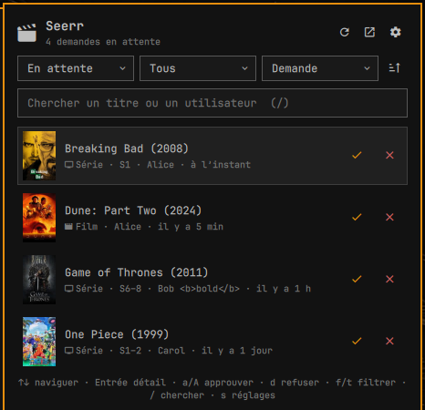

# OmaSeerr

[Seerr](https://github.com/seerr-team/seerr) media requests in the [Omarchy](https://omarchy.org) bar.



- **Bar icon** with the number of pending requests (red `!` when Seerr is unreachable).
- **Panel**: requests with posters, filter by status and media type, sort by request or update date, search by title or user.
- **Details**: poster, synopsis, genres, requested seasons, who asked and when, who handled it.
- **Approve with options**: choose the Radarr/Sonarr server, quality profile, root folder, language profile, tags and seasons, like Seerr's own approval dialog (anime defaults included). **Shift+click** (or `A`) approves straight away with Seerr's defaults.
- **Decline, retry, delete** (with confirmation).
- **Notifications** for new requests with **Details / Approve / Decline** buttons. Approve from a notification is a quick approval. Several new requests at once can be grouped, and optional notifications when a request becomes available or fails.
- **Everything is configurable** from the panel's settings (gear icon) or `shell.json`.
- English and French; follows the language chosen in Omarchy.

## Install

```bash
omarchy plugin add https://github.com/myouboku/omaseerr --enable
```

Then click the icon: the panel opens on its settings. Enter the Seerr URL (`http://` or `https://`) and the API key from **Seerr › Settings › General**.

### The API key

The key is kept in your keyring through the Secret Service (`secret-tool`, which gnome-keyring or KeePassXC provide), under `service=myouboku.omaseerr account=api-key`. It never goes into `shell.json`, a file, or a command line. To manage it by hand:

```bash
secret-tool store --label="OmaSeerr (Seerr API key)" service myouboku.omaseerr account api-key   # paste, then Ctrl+D
omarchy-shell myouboku.omaseerr reloadKey
```

A key that cannot manage requests (neither admin nor *Manage Requests*) still lists them, but the approve and decline actions are hidden.

**HTTP or HTTPS** both work. The panel warns when plain HTTP points outside your local network, since the key then travels unencrypted. For HTTPS, the certificate must be valid (self-signed certificates are refused).

## Keyboard

| Key | List | Details |
|-----|------|---------|
| `↑` `↓` / `j` `k` | move | |
| `Enter` | details | approve… |
| `a` | approve with options | approve with options |
| `A` / `Shift+Enter` | quick approve | quick approve |
| `d` | decline | decline |
| `x` / `Delete` | delete | delete |
| `R` | retry a failed request | retry |
| `o` | open in Seerr | open in Seerr |
| `f` / `F` | next / previous status filter | |
| `t` | next media type | |
| `S` / `i` | sort field / direction | |
| `/` | search (`Enter` or `↓` back to the list) | |
| `r` | refresh | |
| `s` | settings | |
| `Esc` | close (clears the search first) | back |

## Settings

All of them are in the panel (gear icon). They are stored in the widget's entry in `~/.config/omarchy/shell.json` and can also be set with `omarchy bar set myouboku.omaseerr <key> <value>` or `omarchy-shell myouboku.omaseerr set <key> <value>`.

| Key | Default | |
|-----|---------|---|
| `url` | | Seerr address, `http://` or `https://` |
| `refreshIntervalSec` | `60` | how often to check for new requests (15–3600) |
| `notifyNewRequests` | `true` | notify new requests |
| `notifyStatusChanges` | `false` | notify when a request becomes available or fails |
| `notifyOnStartup` | `false` | announce the requests already pending at the first connection |
| `notifyUrgency` | `normal` | `low`, `normal`, `critical` |
| `notifyPoster` | `true` | poster in notifications (downloaded from TMDB, cached in `~/.cache/omaseerr`) |
| `notifyGroupThreshold` | `3` | one grouped notification from this many new requests (`1` never groups) |
| `defaultFilter` | `pending` | `pending`, `approved`, `processing`, `available`, `failed`, `declined`, `all` |
| `defaultMediaType` | `all` | `all`, `movie`, `tv` |
| `defaultSort` | `added` | `added`, `modified` |
| `defaultSortDirection` | `desc` | `desc`, `asc` |
| `pageSize` | `20` | requests per page (5–100) |
| `showPosters` | `true` | posters in the panel (loaded from image.tmdb.org) |
| `showBadge` | `true` | pending count on the bar icon |
| `badgeWhenEmpty` | `false` | show the count when it is zero |
| `confirmDecline` | `true` | ask before declining |

## IPC

```bash
omarchy-shell myouboku.omaseerr status          # connected pending=3 total=42
omarchy-shell myouboku.omaseerr pending         # 3
omarchy-shell myouboku.omaseerr open | toggle | refresh
omarchy-shell myouboku.omaseerr show <id>       # open the panel on a request
omarchy-shell myouboku.omaseerr approve <id>    # quick approve
omarchy-shell myouboku.omaseerr decline <id>
omarchy-shell myouboku.omaseerr get|set <key> [value]
```

A Hyprland binding, for example in `~/.config/hypr/bindings.lua`, can open the panel with `omarchy-shell myouboku.omaseerr toggle`.

## Network and privacy

The plugin talks to your Seerr instance only. It checks it every `refreshIntervalSec` seconds while connected (the count, the 50 newest pending requests, and the 50 latest updates when status notifications are on). Posters come from `image.tmdb.org` unless both poster settings are off. Answers are size-limited and validated, and text from Seerr is always displayed as plain text. Seen request ids are kept in `~/.local/state/omaseerr/state.json` so a restart does not announce them again.

## Development

```bash
node tests/run.js                       # model tests
node dev/mock-seerr.js                  # fake Seerr on http://127.0.0.1:5055, key devkey1234567890
curl -X POST 'http://127.0.0.1:5055/__mock/new?type=tv'   # a new pending request
docker compose -f dev/compose.yaml up -d                  # a real Seerr, Jellyfin, Radarr, Sonarr
```

Link the checkout as a plugin with `ln -s "$PWD" ~/.config/omarchy/plugins/myouboku.omaseerr`, then `omarchy plugin enable myouboku.omaseerr --section right`. After changing a QML file, `omarchy restart shell` is the reliable way to reload it: the shell keeps already-compiled QML types in memory.

| File | Role |
|------|------|
| `manifest.json` | plugin id, kinds (`service` + `bar-widget`), settings schema |
| `Service.qml` | the single instance: keyring, HTTP, polling, notifications, actions, IPC |
| `Panel.qml` | bar icon and panel (one per monitor), all views |
| `model/Seerr.js` | pure logic: URLs, payload validation, statuses, filters, approval form |
| `i18n/*.json` | translations |
| `tests/` | `node` tests for the model |
| `dev/` | fake Seerr and a Docker stack with a real one |
